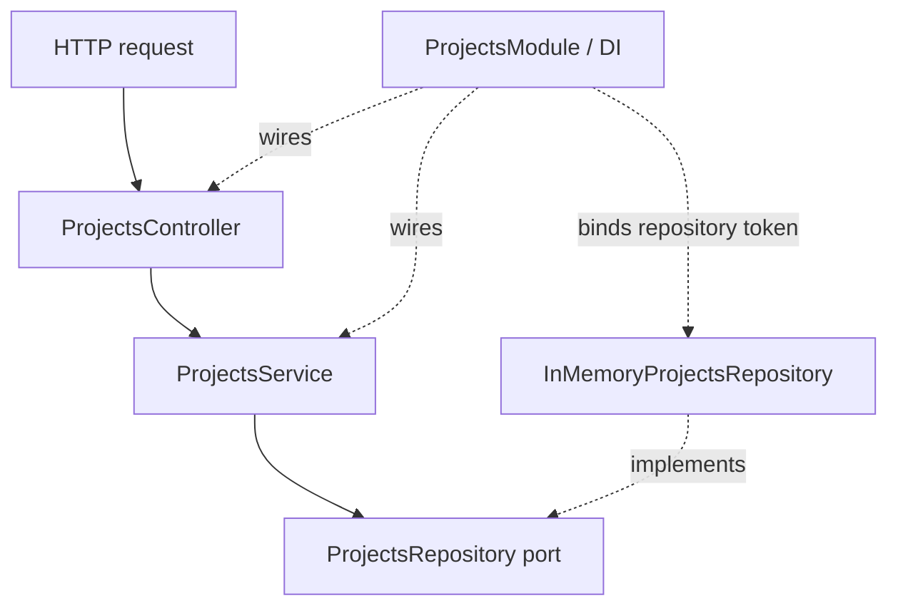

# freim-work

## Projects CRUD API

This NestJS vertical slice exposes endpoints to create, list, retrieve, update, and delete projects. Project records are currently stored in memory and reset when the server restarts.

### Dependency graph



The controller maps HTTP requests to service calls. The service handles application behavior and relies on the repository port for data access. The module binds that port to its in-memory adapter through dependency injection.

### Routes

| Method | Path | Operation |
|---|---|---|
| `POST` | `/projects` | Create a project |
| `GET` | `/projects` | List projects |
| `GET` | `/projects/:id` | Retrieve one project |
| `PATCH` | `/projects/:id` | Update a project |
| `DELETE` | `/projects/:id` | Remove a project |

`POST /projects` accepts a required `name` (3–100 characters) and `status` (`draft`, `active`, or `completed`), plus an optional `description` (up to 500 characters). `PATCH /projects/:id` accepts any subset of those fields with the same validation rules. Unknown properties and non-numeric IDs are rejected with `400 Bad Request`.

Responses use `ProjectResponseDto`, which exposes only `id`, `name`, `description`, `status`, and `createdAt`. Errors share this shape:

```json
{
  "statusCode": 404,
  "errorCode": "PROJECT_NOT_FOUND",
  "message": "Project with id 10 was not found",
  "path": "/projects/10",
  "timestamp": "2026-09-23T10:00:00.000Z",
  "traceId": "550e8400-e29b-41d4-a716-446655440000"
}
```

Send an `x-trace-id` header to include a caller-provided trace ID; otherwise the API generates one.

### API documentation

- Swagger UI: `http://localhost:3000/docs`
- OpenAPI JSON: `http://localhost:3000/openapi.json`
- Generate the checked-in document: `npm run openapi:generate`
- Lint the generated document with Redocly: `npm run lint:openapi`
- Source repository: [freim-work practical](https://github.com/vladdemi-bot/freim-work)

The OpenAPI document includes an HTTP bearer/JWT security scheme for consumers, but the current API does not enforce authentication.

### Контрольні запитання

- **Чим contract-first відрізняється від code-first?** У contract-first спочатку погоджують OpenAPI-контракт і вже за ним реалізують API. У code-first спочатку пишуть код, а документацію генерують з нього.
- **Чому undocumented error є дефектом контракту?** Клієнт не може передбачити формат і значення помилки, тому не може надійно обробити її чи показати користувачу.
- **Що входить до breaking change?** Зміна, що може зламати сумісного клієнта: видалення або перейменування endpoint/поля, зміна типу чи обов’язковості поля, зміна статус-коду або формату відповіді без сумісного переходу.

### Run locally

```powershell
npm install
npm run build
npm run start
```
