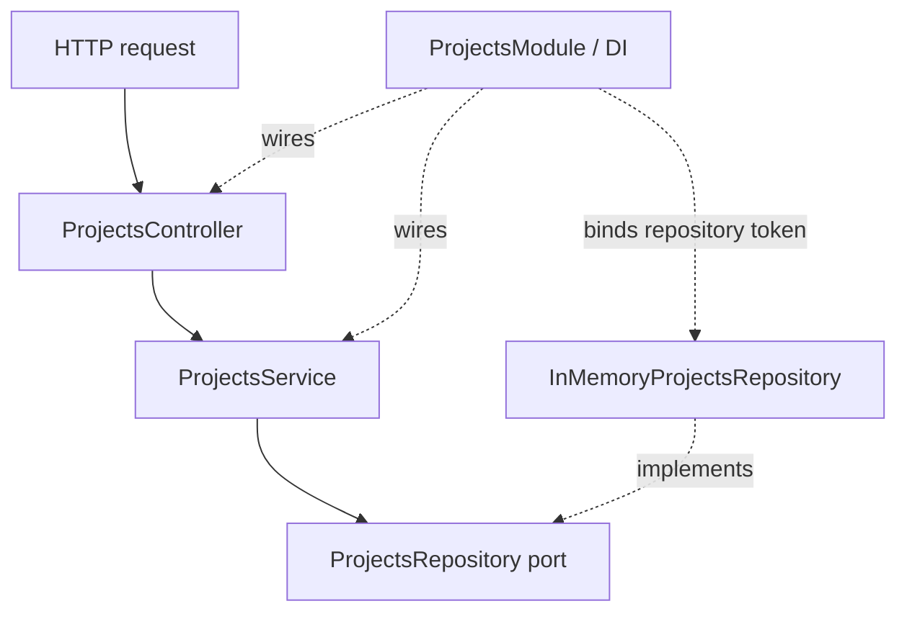

# freim-work

## Projects CRUD API

This NestJS vertical slice exposes endpoints to create, list, retrieve, update, and delete projects. Project records are currently stored in memory and reset when the server restarts.

### Dependency graph



The controller maps HTTP requests to service calls. The service handles application behavior and relies on the repository port for data access. The module binds that port to its in-memory adapter through dependency injection.

### Routes

| Method | Path | Operation |
|---|---|---|
| `POST` | `/projects` | Create a project |
| `GET` | `/projects` | List projects |
| `GET` | `/projects/:id` | Retrieve one project |
| `PATCH` | `/projects/:id` | Update a project |
| `DELETE` | `/projects/:id` | Remove a project |

`POST /projects` accepts a required `name` (3–100 characters) and `status` (`draft`, `active`, or `completed`), plus an optional `description` (up to 500 characters). `PATCH /projects/:id` accepts any subset of those fields with the same validation rules. Unknown properties and non-numeric IDs are rejected with `400 Bad Request`.

Responses use `ProjectResponseDto`, which exposes only `id`, `name`, `description`, `status`, and `createdAt`. Errors use `application/problem+json` and follow this Problem Details shape:

```json
{
  "type": "https://example.com/problems/project-not-found",
  "title": "Project not found",
  "status": 404,
  "detail": "Project with id 10 was not found",
  "instance": "/projects/10",
  "code": "PROJECT_NOT_FOUND",
  "requestId": "550e8400-e29b-41d4-a716-446655440000"
}
```

The API returns an `X-Request-Id` response header. A caller can provide `x-request-id`; otherwise the API generates one. Server errors are logged with the request ID and return only a generic detail to clients.

### API documentation

- Swagger UI: `http://localhost:3000/docs`
- OpenAPI JSON: `http://localhost:3000/openapi.json`
- Generate the checked-in document: `npm run openapi:generate`
- Lint the generated document with Redocly: `npm run lint:openapi`
- Source repository: [freim-work practical](https://github.com/vladdemi-bot/freim-work)

The OpenAPI document includes an HTTP bearer/JWT security scheme for consumers, but the current API does not enforce authentication.

### Контрольні запитання

- **Чим contract-first відрізняється від code-first?** У contract-first спочатку погоджують OpenAPI-контракт і вже за ним реалізують API. У code-first спочатку пишуть код, а документацію генерують з нього.
- **Чому undocumented error є дефектом контракту?** Клієнт не може передбачити формат і значення помилки, тому не може надійно обробити її чи показати користувачу.
- **Що входить до breaking change?** Зміна, що може зламати сумісного клієнта: видалення або перейменування endpoint/поля, зміна типу чи обов’язковості поля, зміна статус-коду або формату відповіді без сумісного переходу.

### Run locally

```powershell
npm install
npm run build
npm run start
```

## Практична робота 4: конфігурація, валідація та помилки

Практичну з API подій адаптовано до наявного NestJS API проєктів. Маршрути залишаються `/projects`; окремий Events API не створювався.

- `src/config/env.ts` завантажує `.env`, перевіряє `PORT`, `NODE_ENV`, `LOG_LEVEL` і `MAX_PROJECTS` за допомогою Zod і завершує запуск із помилкою при невалідних значеннях.
- `.env.example` описує потрібні змінні, а `.env` ігнорується Git.
- `src/projects/project.schemas.ts` та `ZodValidationPipe` перевіряють body і id: невідомі поля заборонені, рядки назви очищуються, id має бути додатним цілим числом, порожній PATCH відхиляється.
- Service перевіряє унікальність назви без урахування регістру та ліміт `MAX_PROJECTS`; конфлікти повертають 409.
- Request ID middleware додає `X-Request-Id`, а глобальний exception filter повертає Problem Details з типом `application/problem+json`. Внутрішні повідомлення й stack trace 500-помилок не потрапляють клієнту.

Приклад успішного створення:

```http
HTTP/1.1 201 Created
Content-Type: application/json
X-Request-Id: 550e8400-e29b-41d4-a716-446655440000
```

```json
{
  "id": 1,
  "name": "StudyFlow",
  "description": "Learning project manager",
  "status": "active",
  "createdAt": "2026-11-04T10:00:00.000Z"
}
```

Приклади єдиного формату помилок:

```json
{
  "type": "https://example.com/problems/validation-error",
  "title": "Request validation failed",
  "status": 400,
  "detail": "Request validation failed",
  "instance": "/projects",
  "code": "VALIDATION_ERROR",
  "requestId": "550e8400-e29b-41d4-a716-446655440000",
  "errors": [{ "field": "name", "message": "Name must contain at least 3 characters" }]
}
```

```json
{
  "type": "https://example.com/problems/project-not-found",
  "title": "Project not found",
  "status": 404,
  "detail": "Project with id 9999 was not found",
  "instance": "/projects/9999",
  "code": "PROJECT_NOT_FOUND",
  "requestId": "550e8400-e29b-41d4-a716-446655440000"
}
```

```json
{
  "type": "https://example.com/problems/project-already-exists",
  "title": "Project already exists",
  "status": 409,
  "detail": "Project with name \"StudyFlow\" already exists",
  "instance": "/projects",
  "code": "PROJECT_ALREADY_EXISTS",
  "requestId": "550e8400-e29b-41d4-a716-446655440000"
}
```

```json
{
  "type": "https://example.com/problems/internal-server-error",
  "title": "Internal server error",
  "status": 500,
  "detail": "An unexpected server error occurred",
  "instance": "/projects",
  "code": "INTERNAL_SERVER_ERROR",
  "requestId": "550e8400-e29b-41d4-a716-446655440000"
}
```

### Перевірка через curl

Запусти `npm run start`, залишивши сервер активним, і виконай запити. Для `PATCH` та повторного `POST` підставляй id/тіло зі створеного запису.

| # | Команда | Очікуваний статус |
|---|---|---:|
| 1 | `curl -i -X POST http://localhost:3000/projects -H "Content-Type: application/json" -d '{"name":"Node Workshop","status":"active"}'` | 201 |
| 2 | `curl -i -X POST http://localhost:3000/projects -H "Content-Type: application/json" -d '{"name":"JS","status":"active"}'` | 400 |
| 3 | `curl -i -X POST http://localhost:3000/projects -H "Content-Type: application/json" -d '{"name":"Valid name","status":"wrong"}'` | 400 |
| 4 | `curl -i -X POST http://localhost:3000/projects -H "Content-Type: application/json" -d '{"name":"Valid name","status":"active","price":50}'` | 400 |
| 5 | `curl -i -X PATCH http://localhost:3000/projects/1 -H "Content-Type: application/json" -d '{}'` | 400 |
| 6 | `curl -i http://localhost:3000/projects/abc` | 400 |
| 7 | `curl -i http://localhost:3000/projects/0` | 400 |
| 8 | `curl -i http://localhost:3000/projects/9999` | 404 |
| 9 | Повторити запит #1 з тією самою назвою | 409 |
| 10 | `curl -i http://localhost:3000/unknown` | 404 |
| 11 | `curl -i http://localhost:3000/projects/error/test` (лише в development) | 500 |

Перевірка конфігурації у PowerShell: перед запуском встанови `$env:PORT='hello'`, `$env:PORT='99999'` або `$env:NODE_ENV='local'`. У кожному випадку застосунок має завершитися з повідомленням `Invalid environment configuration`; після цього очисти змінну командою `Remove-Item Env:PORT` або `Remove-Item Env:NODE_ENV`.

Локальна перевірка виконана: створення повернуло 201; успішний PATCH і GET — 200; дубль назви та перевищення ліміту — 409; некоректне тіло, порожній PATCH та id `abc`/`0` — 400; відсутній проєкт і маршрут — 404; тестова внутрішня помилка — 500; список — 200. Відповіді на помилки мали `Content-Type: application/problem+json` і `X-Request-Id`; успішне створення відобразило переданий `x-request-id`. Для перевірки ліміту сервер запускали з `MAX_PROJECTS=1`. Три неправильні значення конфігурації вище завершили процес із кодом 1.

### Контрольні запитання

- **Чому змінні середовища потрібно перевіряти під час запуску?** Щоб помилкова конфігурація не призводила до неочікуваної поведінки після початку обробки запитів.
- **Чому типів TypeScript або JSDoc недостатньо для перевірки HTTP JSON?** Вони не перевіряють дані, що надійшли під час виконання; JSON з мережі може мати неправильні типи, поля або значення.
- **Чим валідація формату відрізняється від перевірки бізнес-правил?** Валідація перевіряє структуру і допустимі значення одного запиту, а бізнес-перевірка враховує поточний стан системи, наприклад дубль назви чи досягнення ліміту.
- **Чому код `PROJECT_NOT_FOUND` корисніший за один текст помилки?** Клієнт може стабільно обробити машинний код незалежно від локалізації чи зміни формулювання повідомлення.
- **Навіщо відповідь із помилкою містить requestId?** Він пов’язує відповідь клієнта із записом помилки в серверному журналі.
- **Чим статуси 400, 404, 409 і 500 відрізняються за змістом?** 400 означає некоректний запит, 404 — відсутній ресурс або маршрут, 409 — конфлікт із поточним станом, 500 — неочікувану серверну помилку.
- **Чому сервер не повинен повертати stack trace клієнту?** Він може розкрити внутрішню структуру, залежності та дані сервера.
- **Чому notFound передає помилку в загальний error handler?** Так невідомий маршрут отримує той самий формат відповіді й request ID, що й інші помилки.
